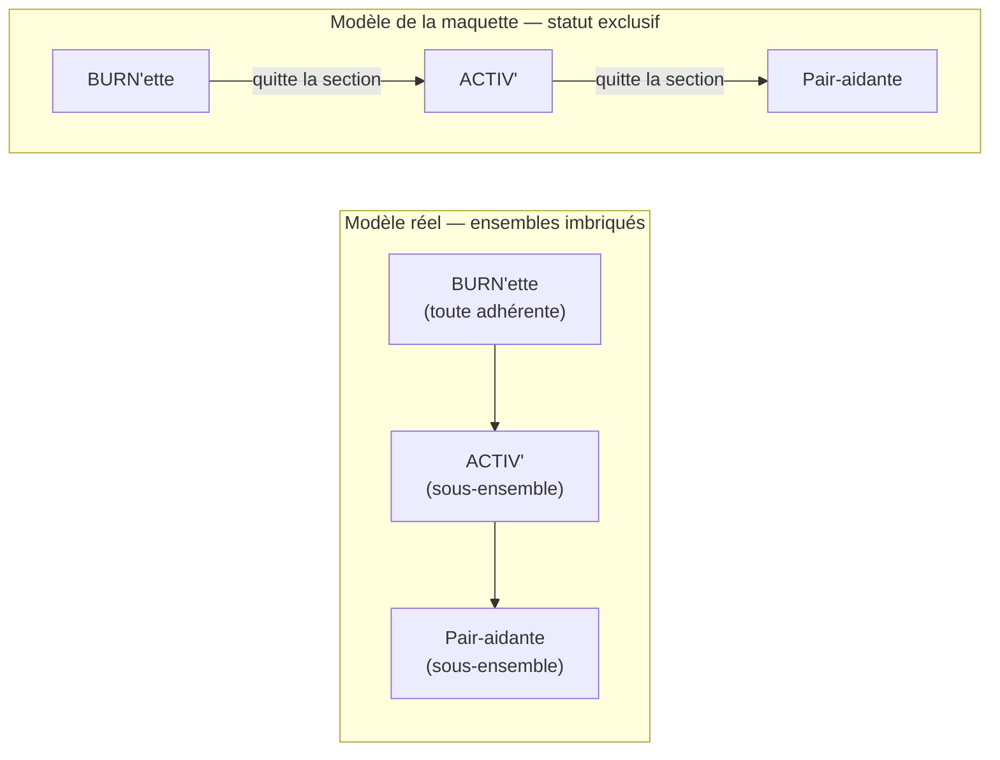

# Maquette retenue vs documentation technique de l'association

> Objectif : vérifier que les données montrées par `passation/prototype/index.html` (la maquette retenue, cf. `passation/cadrage/4-prototype.md`) correspondent aux données et au besoin réels de L'BURN. Sources : `docs/contexte-lburn-docs/02-glossaire.md`, `06-donnees-et-technique.md`, `09-hackathon-theme2-activ-problemes.md`.
>
> Légende : ❗️ erreur de modèle à corriger avant de coder · ❓ question à poser à l'équipe · 🎯 hypothèse de build acceptable, à valider au tour de test.

## Verdict

**Non**, pas telles quelles. Le vocabulaire est bon (orthographe ACTIV'/BURN'ette/Pair-aidante respectée), mais le **modèle de données sous-jacent au statut est faux** : la maquette traite BURN'ette/ACTIV'/Pair-aidante comme un statut unique et exclusif, alors que l'association les définit comme des ensembles imbriqués. C'est le point ❗️ principal ; les autres sont plus ponctuels.

---

## 1. ❗️ Statut exclusif dans la maquette vs ensembles imbriqués chez l'asso

**Ce que montre la maquette** : un seul `badge-statut` par profil (BURN'ette *ou* ACTIV' *ou* Pair-aidante), trois sections de dashboard qui s'excluent, une barre de progression `done → current → à venir` qui laisse entendre qu'on *quitte* une étape en passant à la suivante.

**Ce que dit l'association** :
- « ACTIV' (personne) = BURN'ette qui suit le module ACTIV' et se remobilise en interne » [GLO p2]
- « Pair-aidante = BURN'ette qui suit le focus pair-aidance du module ACTIV'. Une pair-aidante est donc aussi une ACTIV' » [GLO p2]
- Distinction officielle à ne pas confondre : « ACTIV' ≠ pair-aidante : toute pair-aidante est ACTIV', pas l'inverse » [GLO p2] (même logique que « Bénéficiaire ≠ adhérente »)
- Côté données : la pair-aidante bénévole est un **rôle** en plus de l'adhérente, pas un statut qui la remplace, et ce rôle doit être **exclu des KPI adhérentes** — ce qui suppose de savoir qu'elle est toujours adhérente [RAD p1][CAD p3]

**Pourquoi ça compte** : si le code reprend un seul champ `statut`, on perd la trace qu'une pair-aidante est adhérente ET BURN'ette ET ACTIV' — données nécessaires ailleurs (KPI adhérentes, filtres par rôle cumulés, §2.1 et §10 de `06-donnees-et-technique.md`).

**Proposition** :
- Remplacer le champ `statut` (enum) par deux marqueurs cumulatifs et datés : `est_activ` (date de validation candidature) et `est_pair_aidante` (date d'habilitation). BURN'ette reste la base implicite (= adhérente).
- Dashboard : garder trois sections pour l'ergonomie (c'est un vrai besoin de tri pour la chargée de remobilisation), mais les peupler par **filtre cumulatif** (« est ACTIV' » inclut les pair-aidantes) plutôt que par partition exclusive, et le dire dans le libellé ou le compteur.
- Un profil doit pouvoir afficher les deux badges à la fois (ACTIV' + Pair-aidante), pas un seul.

---

## 2. ❗️ Incohérence interne à la maquette (pas un écart avec l'asso, mais un bug à ne pas recoder)

Dans `prototype/index.html`, Sophie Lefebvre est rangée dans la section **« BURN'ettes »** avec le badge **« BURN'ette »** (screen 1), mais sa propre barre de progression affiche BURN'ette *terminé* et **ACTIV' en cours** — et sur sa fiche (screen 2) elle est bien présentée comme « BURN'ette × ACTIV' ». Avec un statut exclusif, elle devrait être dans la section ACTIV', pas BURN'ettes. C'est la conséquence directe du point 1 : tant que le modèle reste un statut exclusif, ce genre d'incohérence va se reproduire dans les vraies données.

---

## 3. ❗️ Formation, habilitation et supervision confondues en un seul geste

Le job to be done de l'itération est précisément : *tracer l'habilitation* quand une formation se termine. Or la maquette ne modélise qu'un bouton unique « Je valide le nouveau statut et l'habilitation », sans champ dédié pour l'habilitation elle-même.

L'association distingue trois données, pas une :
- formation terminée, datée (tronc commun étape 11, formation modération étape 13, formation pair-aidance étape 14) [CAR p3][CAR p4]
- **habilitation** tracée, datée — explicitement nommée comme donnée manquante aujourd'hui : « Habilitation non tracée : risque d'intervenir sans » [CAR p4]
- **supervision** — mais comme état *récurrent*, pas une case à cocher une fois : l'indicateur demandé est « % de pair-aidantes **à jour** de supervision » [CAR p4], pas « a fait sa supervision ».

La maquette traite « Supervision pair-aidance » comme une formation à faire une seule fois (liste « À faire », icône `○`), ce qui ne permet pas de calculer cet indicateur plus tard.

**Proposition** :
- Champs séparés : `date_fin_formation`, `date_habilitation`, et `derniere_supervision` (date) d'où se calcule `supervision_a_jour` (booléen dérivé, règle de fraîcheur à définir avec l'équipe ❓).
- Le bouton peut rester un seul clic dans l'UI (simplicité pour la chargée de remobilisation), mais doit écrire au moins `date_habilitation` en plus du statut — sinon rien ne distingue "elle est pair-aidante" de "son habilitation est tracée", qui est justement la mesure de succès de l'hypothèse de la squad.

---

## 4. ❓ Antenne : texte libre dans la maquette, référentiel par ID chez l'asso

La maquette affiche l'antenne en texte libre : « Antenne Talence », « Antenne Lille », « Antenne Agen », « Antenne Mimizan ».

Deux problèmes :
- Règle technique : « Rattachement antenne par `branch` (ID numérique du CPT location), identique sur le profil utilisatrice et sur la session, **jamais par texte libre** » [RAD p1][RMP p4]. Une session n'est visible que si sa `branch` = celle de l'utilisatrice, et un accès à une autre antenne par URL directe doit être bloqué [RAD p2] — un champ texte libre ne permet pas ce filtrage de façon fiable (doublons d'orthographe, pas de clé stable).
- Le référentiel technique des antennes est **par département** : Gironde (33), Lot-et-Garonne (47), Nord (02/59/60/62/80), antenne virtuelle [RMP p4]. Les villes citées dans la maquette (Talence, Lille, Agen, Mimizan) viennent de la description de l'association dans `passation/PASSATION.md` (« antennes à Lille, Agen, Marmande, Mimizan »), pas de ce référentiel. Les deux ne se recouvrent pas terme à terme (ex. « Mimizan » n'apparaît dans aucun des deux référentiels techniques cités).

**Proposition** : ne pas inventer un nouveau référentiel d'antennes pour le prototype. Poser la question ❓ au développeur/à l'équipe de cadrage avant l'itération qui touche ce champ : quel référentiel fait foi pour ACTIV' (villes ou départements) ? En attendant, traiter l'antenne comme une valeur d'exemple non structurante plutôt que comme une clé de filtrage.

---

## 5. ❓ Transition BURN'ette → ACTIV' non tracée (candidature absente)

La maquette expose un bouton de statut générique qui, visuellement, permettrait de faire avancer n'importe qui de BURN'ette à ACTIV' aussi facilement que de ACTIV' à Pair-aidante. Mais l'accès à ACTIV' n'est pas un simple geste de back-office :
- « à partir du parcours BIB, en option, sur candidature » [GLO p1][MOD p1]
- « les ACTIV' sont sélectionnées par l'association » [CAR p5], via une candidature + un entretien avec la chargée de remobilisation (étapes 9-10) [CAR p2]
- L'objet « Candidature ACTIV' » (statut, questionnaire, entretien, décision) est explicitement listé comme **à créer**, pas encore modélisé [CAD p3]

Le job to be done réel de cette itération ne concerne que la transition ACTIV' → Pair-aidante (fin de formation pair-aidance). Rien ne demande de permettre la création d'ACTIV' depuis le dashboard.

**Proposition** : ne pas généraliser le bouton « valider le statut » aux deux transitions. Dans le prototype développé, ne rendre cliquable que ACTIV' → Pair-aidante ; traiter BURN'ette → ACTIV' comme hors périmètre explicite de cette itération (candidature = futur sujet), plutôt que comme une fonctionnalité symétrique qui existerait déjà.

---

## 6. ❓ Import Excel : colonnes inconnues

La bannière « Importer un fichier Excel » suppose un mapping automatique colonne → champ. Mais : « Colonnes des fichiers Excel actuels de suivi ACTIV' : inconnues » [CAD p3], et l'hypothèse H7 (« le back-office remplace intégralement les fichiers Excel ») n'est pas vérifiée [CAD p3].

L'association a déjà un précédent pour ce genre de cas : l'outil « Imports de paiements HelloAsso » ne fait pas un mapping automatique, il propose une **correspondance manuelle des colonnes** [RAD p3, §4.4].

**Proposition** : ne pas coder de mapping automatique de colonnes dans cette itération. Si l'import Excel est repris, prévoir une étape de correspondance manuelle (comme pour HelloAsso) ou, plus simple pour un budget de 10 minutes, se limiter à un import de démonstration avec des colonnes fixes déclarées à l'équipe, en signalant que le vrai fichier n'a pas été vu.

---

## 7. 🎯 Filtrage par antenne absent pour la directrice d'antenne

Le sélecteur « Qui êtes-vous ? » (prévu par le PRD, hors maquette HTML) permet d'incarner la directrice d'antenne, mais le dashboard de la maquette n'a pas de filtre par antenne — seulement un filtre par statut. Or : « Directrice d'antenne / admin d'antenne : périmètre technique uniquement son antenne (sessions, contenus, KPI) » [GLO p2][RAD p1], et une régression connue existe déjà sur ce point ailleurs dans la plateforme (adhérentes qui voyaient les ateliers de toutes les antennes, sept. 2026) [RAD p1].

**Proposition** : ce n'est pas un défaut de la maquette (elle ne simule qu'un seul jeu de données), mais à anticiper dès que le modèle de données est posé : prévoir un champ antenne sur l'« utilisateur joué » et filtrer le dashboard en conséquence quand le rôle directrice d'antenne sera réellement exercé — pas forcément dans l'itération 1, mais à noter dans `ITERATIONS.md` / `adr.md` pour ne pas l'oublier.

---

## Ce qui est déjà correctement cadré (pas à refaire)

- Vocabulaire et graphie : ACTIV', BURN'ette, Pair-aidante — conformes [GLO p2].
- Points et badges de succès : absents de la maquette, et déjà listés hors périmètre dans `PASSATION.md` — cohérent avec le fait que ce ne sont que des pistes de la note de cadrage, non actées [MOD p1].
- Calendrier de disponibilités en fiche profil : présent dans le HTML mais déjà signalé hors périmètre dans `PASSATION.md` — à ne pas développer, juste à retirer de l'écran si le temps le permet.
- Pas de connexion / comptes : conforme à la consigne « Qui êtes-vous ? » sans mot de passe.

---

## À trancher avant de coder (résumé)

| # | Point | Type | Bloquant pour quelle itération |
|---|---|---|---|
| 1 | Statut exclusif vs ensembles imbriqués | ❗️ modèle de données | Dès la fiche profil et le dashboard |
| 2 | Incohérence Sophie Lefebvre | ❗️ artefact maquette | À ne pas reproduire en codant |
| 3 | Habilitation/supervision non distinguées | ❗️ modèle de données | Dès l'édition du statut (cœur de l'hypothèse) |
| 4 | Antenne texte libre vs référentiel `branch` | ❓ question équipe | Peut attendre si l'antenne reste cosmétique |
| 5 | Candidature ACTIV' absente | ❓ scope | À limiter explicitement dans le plan |
| 6 | Import Excel, colonnes inconnues | ❓ question équipe | Si l'import est repris tel quel |
| 7 | Filtrage par antenne (directrice) | 🎯 hypothèse de build | Pas bloquant pour l'itération 1 |

---

## Décisions du développeur (2026-11-18)

| # | Arbitrage |
|---|---|
| 1 | Ensembles imbriqués acceptés **côté données**, mais le visuel de progression de la maquette initiale est conservé tel quel (évolution, pas remplacement). Voir entrée `adr.md` du 2026-11-18. |
| 2 | Pas important, pas retenu. |
| 3 | Champs séparés (formation / habilitation / supervision) acceptés côté données, le visuel (bouton unique) est conservé. |
| 4 | Reporté — pas traité aujourd'hui. |
| 5 | Accepté, avec précision : la sous-progression se gère **à l'intérieur de chaque statut** sur la fiche profil (ex. candidature ACTIV' « en cours » / « habilitée »). Proposition graphique à faire à la prochaine préparation d'itération, avant de coder. |
| 6 | Accepté tel que proposé (correspondance manuelle plutôt que mapping automatique). |
| 7 | Antennes non gérées dans cette session. |
