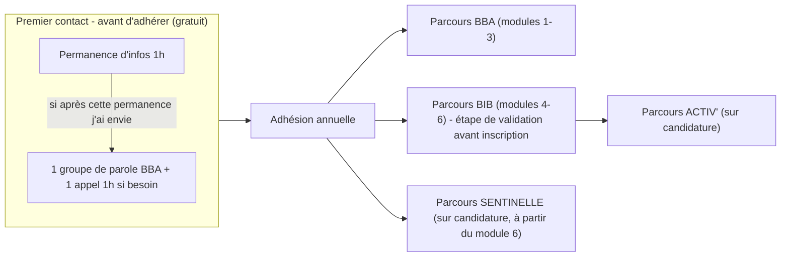
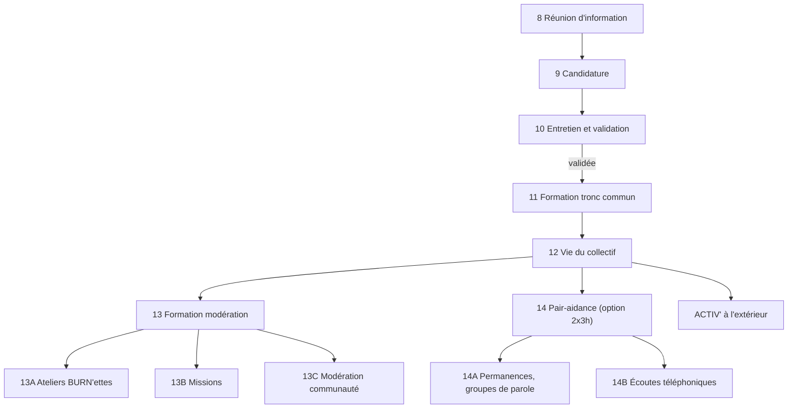

# Workflows et parcours utilisateur

> Enchaînements d'étapes décrits par L'BURN (premier contact → adhésion → parcours, réservation, paiement, renouvellement, parcours ACTIV', administration), avec statut et source pour chaque élément. Sources : VIS, GLO, RMP, RAD, CAR, MOD, CAD, PER.

Légende statuts : ✅ actuel/existant · 🎯 cible · 🟢 décidé/validé · 🟡 piste non actée · ❓ question ouverte/hypothèse · ⛔ hors périmètre/reporté.

Voir aussi : [01-association-offre-parcours.md](01-association-offre-parcours.md) · [02-glossaire.md](02-glossaire.md) · [04-regles-metier.md](04-regles-metier.md) · [05-administration-roles-securite.md](05-administration-roles-securite.md) · [06-donnees-et-technique.md](06-donnees-et-technique.md) · [09-hackathon-theme2-activ-problemes.md](09-hackathon-theme2-activ-problemes.md).

## À retenir pour le build

- Chemin global : premier contact gratuit (permanence d'infos 1h) → adhésion annuelle → parcours BBA / BIB / ACTIV' / SENTINELLE (ACTIV' et SENTINELLE sur candidature) [VIS p1].
- ✅ Tout paiement passe par HelloAsso, en popup ou nouvel onglet, jamais en iframe ; confirmation par webhook + URL de retour HelloAsso [RMP p2].
- ✅ Réservation d'atelier : jauge non dépassable, max 3 ateliers par adhérente et par mois, pas de chevauchement horaire [RMP p3].
- ✅ Liste d'attente : quand une place se libère, toutes les personnes en attente sont prévenues en même temps, premier arrivé premier servi, sans inscription automatique [RMP p3][RAD p3].
- 🟢 Annulation d'un atelier payé (US519, option semi-automatique validée) : demande de remboursement → remboursement manuel dans HelloAsso → email de confirmation [RMP p2].
- ✅ Adhésion = 12 mois glissants ; notifications à J-15 et J-7 ; à l'expiration, accès révoqué et redirection vers le renouvellement (S482, S483) [RMP p1].
- ACTIV' : étapes 8 à 14 (+ ACTIV' à l'extérieur, fin d'engagement) [CAR p1] ; accès « à partir du parcours BIB, en option, sur candidature » [MOD p1], « uniquement pour celles qui suivent le parcours BIB » [GLO p1] ; option ouverte aux BURN'ettes en phase de projection ; engagement d'un an maximum, sortie quand elles le veulent, pause à tout moment [CAR p5].
- Prérequis bloquants ACTIV' : formation modération (13) avant 13A/13B/13C ; formation pair-aidance (14) avant 14A/14B [CAR p5].
- Toute proposition d'activité passe par soumission, validation et modération (équipe ou directrice d'antenne) ; aucune activité publiée sans validation [CAD p3][CAD p4][PER p4].
- Contrainte technique ACTIV' : « réutiliser le moteur de sessions et de réservation plutôt que d'en créer un second » [CAD p3].

## 1. Premier contact → adhésion → parcours

Source unique de l'enchaînement : diapositive « L'accompagnement L'BURN » [VIS p1].

1. **Premier contact, avant d'adhérer (gratuit)** [VIS p1]
   1. « Je découvre l'asso » → permanence d'infos 1h : 20 min définition officielle du BO et stades de rétablissement / 20 min fonctionnement de l'asso / 20 min QR [VIS p1].
   2. Si envie après la permanence : accès à 1 groupe de parole BBA et 1 appel téléphonique d'1h si besoin [VIS p1].
   - Équivalent glossaire : Parcours Découverte (0 €) = une permanence découverte, un seul accès à un groupe de parole, un appel téléphonique sur demande ; ⛔ « Reporté hors hackathon » [GLO p1].
   - Permanence découverte : le jeudi matin à Bordeaux ; objectif : que la personne se sente bien, vérification de la prise en charge, explication globale de l'association [GLO p1].
2. **Adhésion annuelle** : « je deviens adhérente » → accès antenne locale / virtuelle (lieu & communauté d'entraide), plateforme en ligne (ressources), programmation mensuelle (groupes de parole, ateliers BURN'ette, ateliers coup de pouce) [VIS p1]. Prix « XX€ par an (plusieurs paliers disponible accessibilité financière) », espace réservé non renseigné [VIS p1]. Paliers réels : voir §3 [RMP p1].
3. **Les parcours** (adhérente qui veut aller plus loin) [VIS p1] :
   - Parcours BURN TO BE ALIVE : modules 1 à 3 (XX€) [VIS p1].
   - Parcours BURN'ette is BACK : modules 4 à 6 (XX€) ; « Une étape de validation précède l'inscription » [VIS p1][GLO p1].
   - Parcours ACTIV' (X€), sur candidature [VIS p1] ; uniquement pour celles qui suivent BIB [GLO p1].
   - Parcours SENTINELLE (X€), sur candidature [VIS p1] ; à partir du module 6 ; ⛔ hors périmètre du hackathon [GLO p1].
   - Chaque parcours donne accès à : ressources + ateliers socles + ateliers Feel Good [VIS p1].
   - Modules : 1 Épuisement, 2 Récupération, 3 Introspection (BBA) ; 4 Projection, 5 Mise en action, 6 Stabilisation (BIB) ; rythme conseillé : un mois par module [GLO p1].

Encadrés et ordre (« avant d'adhérer » → « je deviens adhérente » → « je suis adhérente et j'ai envie d'aller plus loin ») : [VIS p1] ; validation BIB, module 6 Sentinelle, lien BIB → ACTIV' : [GLO p1][MOD p1].

Non-adhérente : bénéficiaire sans adhésion, sans compte utilisateur (CPT beneficiaire), suivie par l'administration, accès aux groupes de parole et permanences uniquement [GLO p2][RMP p1].

## 2. Parcours bénéficiaire (orientation)

- Numérotation des étapes du parcours bénéficiaire : seules des références isolées existent — « Règles de réservation (étape 9 du parcours bénéficiaire) » [RMP p3] ; verbatim « Je peux maintenant aider les autres. » — L'BURN, étape 5 du parcours [CAD p1] ; mesure existante « Nombre d'ateliers réalisés et remplissage (étape 5), pas par animatrice » [CAR p3] ; friction « Mêmes freins d'accès aux vidéos qu'à l'étape 6 » [CAR p3] ; « Parcours V1 Étapes 1 à 7 » [CAR p1]. Liste complète des étapes 1 à 7 : Non précisé dans les sources.
- Guidage attendu de la plateforme (« orientation personnalisée plutôt qu'un catalogue ») [PER p4] :
  1. un repérage ou une auto-évaluation de sa situation ;
  2. une proposition de stade, présentée comme une orientation et non comme un diagnostic médical ;
  3. une sélection de ressources, ateliers et contacts adaptés ;
  4. un suivi de ses avancées dans un carnet de bord ;
  5. une réorientation possible selon l'évolution de son état et de ses besoins.
- ✅ Quiz connecté (adhérentes connectées) : 35 questions, Likert 1 à 5 → stade dominant = moyenne de section la plus haute → enregistré dans current_stage [RMP p4].
  - Départage en cas d'égalité (décimales non arrondies, ou auto-positionnement graphique) : composant inexistant, repli temporaire en attendant [RMP p4].
- ✅ Le stade pilote les ressources recommandées (onglet « Pour moi ») et la mise en avant des sessions [RMP p5].
- ✅ BAT : visiteuses non connectées du site vitrine, aucun lien avec le quiz [RMP p4][GLO p2].

## 3. Adhésion, paiement, renouvellement

### 3.1 Création de l'adhésion

| Sous-statut | Montant | Création | Source |
|---|---|---|---|
| Plein tarif | 50 € | Paiement HelloAsso | [RMP p1] |
| Plein tarif + solidaire | Plus de 50 € | Paiement HelloAsso avec don supplémentaire | [RMP p1] |
| Tarif réduit | Entre 1 et 49 € | Paiement HelloAsso | [RMP p1] |
| Gratuité | 0 € | Création manuelle sur la plateforme, hors HelloAsso | [RMP p1][RAD p2] |

Flux ✅ paiement [RMP p2] :
1. La page de paiement HelloAsso s'ouvre en popup ou nouvel onglet (jamais iframe : blocage CSP depuis mars 2026).
2. HelloAsso envoie le webhook ; getMode() range la transaction par libellé exact :
   - `Inscription atelier - [nom] - [date courte] - [date complète]` → Session (exemple de montant observé : 3 à 9 €) ;
   - `Adhésion annuelle - [Prénom Nom]` → Adhésion, création (exemple observé : 50 €) ;
   - `Renouvellement adhésion - [Prénom Nom]` → Adhésion, renouvellement (exemple observé : 50 €).
3. Libellé inconnu → HTTP 400 ; HelloAsso réessaie 16 fois sur 27 heures puis abandonne.
4. Confirmation : webhook + URL de retour HelloAsso.
- Les gratuités (0 €) sont créées à la main et n'ont aucune trace HelloAsso ; les identifiants order.id et payment.id ne sont pas stockés [RMP p2].
- ❓ Seuil exact entre tarif réduit et plein tarif + solidaire ; justificatif demandé [RMP p6].
- Le statut « abonnée » doit être renseigné lors d'une adhésion, sinon la personne ne remonte pas dans le KPI des adhérentes [RAD p2].

🎯 Adhésion solidaire (cible) :
1. Demande d'adhésion solidaire → envoi automatique du questionnaire de création de compte [RMP p2].
2. L'administration n'est notifiée que lorsque toutes les informations sont reçues [RMP p2].
   - Un compte solidaire ne doit pas fausser les KPI des adhérentes classiques [RMP p2].
3. Cible : même circuit HelloAsso (formulaire, paiement ou validation à 0 €, création automatique du compte par webhook), ❓ à condition qu'un tarif strict à 0 € soit configurable dans HelloAsso [RAD p2][RAD p5].

### 3.2 Renouvellement et expiration ✅

1. Date de renouvellement = date d'adhésion + 1 an, générée automatiquement, visible et modifiable en back-office ; adhérente sans date signalée [RMP p1][RAD p2].
2. Notification à J-15 puis à J-7, chacune avec la procédure de renouvellement [RMP p1].
3. Paiement libellé `Renouvellement adhésion - [Prénom Nom]` ; met à jour la fiche contact (date d'origine écrasée) [RMP p2].
4. À l'expiration : accès plateforme, ateliers et contenus réservés révoqué automatiquement ; redirection vers la fenêtre de renouvellement avec message clair à la connexion (S482, S483) [RMP p1][RAD p2].
5. 🎯 Adhérentes expirées repérables dans une liste d'inactives en back-office ; rôle « Adhérente inactive » non confirmé comme livré [RAD p1][RAD p2].
- Les profils migrés depuis HelloAsso sans date de renouvellement sont identifiés et traités [RMP p1].
- ❓ Renouvellement avant l'expiration : la nouvelle date repart-elle de l'expiration ou du nouveau paiement ? [RMP p6]
- ❓ Date de souscription : HelloAsso (date du paiement) ou WordPress (date d'adhésion) en cas d'écart ? [RMP p5][RMP p6]

## 4. Réservation d'atelier, liste d'attente, annulation

### 4.1 Réservation (étape 9 du parcours bénéficiaire) ✅ [RMP p3]
1. Visibilité : session visible si la branch de l'utilisatrice est égale à celle de la session ; un accès direct par URL à une session d'une autre antenne « doit être bloqué » ; la visibilité élargie d'un atelier virtuel passe par l'ouverture à toutes les antennes [RAD p2]. Un atelier virtuel créé par une antenne compte pour cette antenne dans les KPI, mais reste visible de toutes les utilisatrices en front-office [RMP p4].
   - ❓ Filtrage des ateliers par antenne : régression constatée en septembre 2026 (les adhérentes voyaient les ateliers de toutes les antennes) [RAD p1] ; correctif délégué au développeur, statut à confirmer [RAD p2][RAD p5].
2. Contrôles à la réservation : jauge non dépassable ; max 3 ateliers / adhérente / mois ; pas de chevauchement horaire [RMP p3][RAD p3].
3. Atelier payant : paiement HelloAsso libellé `Inscription atelier - …` (voir §3.1) [RMP p2].
- Les suggestions ne pointent que vers des sessions datées [RMP p3].

### 4.2 Liste d'attente ✅
1. Session complète → inscription en liste d'attente + notification de confirmation [RMP p3].
2. Place libérée → email à toutes les personnes en attente avec lien d'inscription [RAD p3][RMP p3].
3. Premier arrivé, premier servi ; pas d'inscription automatique [RMP p3][RAD p3].
- Champ : user_workshops_waitinglist (même format que user_sessions) [RMP p3].
- ❓ Retrait de la liste d'attente quand la personne s'inscrit finalement : non géré, point ouvert [RMP p3][RMP p7].

### 4.3 Annulation d'une participation
1. La personne reçoit une notification de confirmation ; l'équipe est prévenue qu'une place est potentiellement libérée [RMP p3].
2. Alerte back-office (nom, atelier, date) ; aucune action pour une session gratuite [RAD p3].
3. Session déjà payée (🟢 US519, semi-automatique) [RMP p2][RAD p3] :
   1. demande de remboursement + notification à l'administration ;
   2. statut « remboursement en attente » dans l'historique de la personne ;
   3. remboursement manuel dans HelloAsso par une personne de l'équipe (pas d'API de remboursement) [RMP p2][RAD p2] ; ❓ droit de l'admin d'antenne à traiter un remboursement : « À confirmer » [RAD p2][RAD p5] ;
   4. l'administration confirme → email de confirmation à la personne [RAD p3][RMP p2].
- ⛔ Dépendance : S523 repose sur la notification d'annulation (S508), sortie du périmètre actif [RAD p3][RAD p4].

### 4.4 Après l'atelier 🎯
- Questionnaire de satisfaction : lien généré par shortcode propre à chaque session (remplace le lien fixe actuel), validé sur au moins deux sessions ; envoi automatique dépendant de Brevo [RMP p3][RMP p4].

## 5. Parcours ACTIV' — cartographie complète

Principe directeur : « l'engagement est un choix. La pause est possible à chaque étape. » [CAR p1]. Les frictions ci-dessous sont des ❓ hypothèses à valider en atelier [CAR p2]. Ligne « Ce qu'on mesure déjà » : « À compléter » sauf mention [CAR p2][CAR p3][CAR p4].

### 5.1 Vue d'ensemble des étapes

1. **8 · Réunion d'information** — phase de projection, +10 mois ; option ouverte quand on est à la phase de projection [CAR p1].
2. **9 · Candidature** — questionnaire et cahier des charges ; condition : 1 an max, sortie libre, sélection par l'asso [CAR p1].
3. **10 · Entretien et validation** — avec la chargée de remobilisation → « validée » [CAR p1].
4. **11 · Formation tronc commun (vidéos)** — psychoéducation, fonctionnement de l'asso ; « La plateforme permet de savoir qu'elles ont regardé les vidéos en entier » [CAR p1] ; mais « Visionnage complet de chaque vidéo : la plateforme doit permettre de le savoir » figure en donnée manquante [CAR p3]. MOD dit : psychoéducation ; posture d'animation d'ateliers [MOD p1].
5. **12 · Vie du collectif** — réunion mensuelle, communauté, chat ; l'asso y transmet ses infos (actus, réunions) ; choix « au sein de l'asso ou dans une entreprise » [CAR p1].
6. **ACTIV' à l'intérieur de l'association** [CAR p1] :
   - **13 · Formation modération** — préalable à 13A, 13B, 13C.
     - 13A · Ateliers BURN'ettes — proposer, animer (ex. jardinage, poterie) ; accès à des créneaux libres (ex. tous les lundis), elles se positionnent, proposent un pitch, l'asso valide avant diffusion.
     - 13B · Missions — ponctuelles : article de blog, intervenir en entreprise ; voir les missions proposées par l'équipe (ex. salon auprès des entreprises avec une salariée).
     - 13C · Modération communauté.
   - **14 · Pair-aidance** — option, 2 × 3 h ; préalable à 14A, 14B.
     - 14A · Permanences, groupes de parole — calendrier où les pair-aidantes s'inscrivent automatiquement.
     - 14B · Écoutes téléphoniques — Calendly pour les RDV avec les bénéficiaires, éventuellement connecté à Google Agenda ; mails automatiques aux bénéficiaires et aux écoutantes ; texte court pour écrire sa problématique, à effacer pour conformité RGPD.
7. **ACTIV' à l'extérieur** — en principe accessible à partir de la phase de stabilisation ; accessible à toute personne au stade remobilisation et mise en action (job meetings, immersion en entreprise…) ; liens vers Job meeting, Immersion Facile ; immersion en entreprise ; bénévolat dans les assos [CAR p1].
8. **Fin d'engagement / transversal** — Pause toujours possible ; Formation Sentinelle (contenu à préciser) [CAR p1][CAR p4].

Nœuds et liens : [CAR p1][CAR p5].

### 5.2 Étapes 8 à 10 [CAR p2]

| | 8 Réunion d'information | 9 Candidature | 10 Entretien et validation |
|---|---|---|---|
| Phase AARRR | Acquisition interne | Activation | Activation |
| Actions | Entend parler du statut (parcours BURN'ette is BACK, chargée d'antenne) ; participe à la réunion d'information | Remplit le questionnaire de motivation ; prend connaissance du cahier des charges et des conditions (1 an max, sortie libre) | Prend rendez-vous avec la chargée de remobilisation ; est sélectionnée ou non par l'asso |
| Points de contact / outils | Réunion d'information ; Email ; Communauté Facebook | Formulaire (outil à préciser) ; Email | Téléphone ; Monday (qualification interne) ; Email |
| Frictions ❓ | Option ouverte en phase de projection : critère (+10 mois) peu lisible pour elle ; risque de se sentir poussée à s'engager | Candidature hors plateforme, pas de statut visible ; cahier des charges sensible : ne stocker que le résultat, jamais les informations de santé | Prise de RDV manuelle ; réponse négative délicate à annoncer, suite à prévoir |
| Donnée manquante | Nombre de BURN'ettes éligibles ; présence à la réunion d'info | Candidatures commencées vs envoyées | Délai candidature → décision ; statut de candidature daté |
| Indicateur candidat | Participantes à la réunion / éligibles | Taux de complétion du questionnaire | Délai moyen candidature → réponse |

### 5.3 Étapes 11 à 13 [CAR p3]

| | 11 Formation tronc commun (vidéos) | 12 Vie du collectif | 13 Formation modération, puis 13A/13B/13C |
|---|---|---|---|
| Phase AARRR | Activation | Rétention | Rétention |
| Actions | Suit les vidéos : psychoéducation, fonctionnement de l'asso | Rejoint la communauté et le chat ACTIV' ; participe à la réunion mensuelle ; reçoit les infos de l'asso ; choisit comment être ACTIV' (dans l'asso ou à l'extérieur) | Suit la formation modération ; 13A : se positionne sur un créneau libre, propose un pitch, l'asso valide avant diffusion ; 13B : choisit parmi les missions proposées par l'équipe ; 13C : modère la communauté |
| Points de contact / outils | Plateforme (formation) ; Youtube | Plateforme (communauté, chat) ; réunion mensuelle | Plateforme (formation, calendrier de créneaux, catalogue de missions) ; HelloAsso ; Brevo (satisfaction) |
| Frictions ❓ | Mêmes freins d'accès aux vidéos qu'à l'étape 6 ; fin de formation qui ne débloque rien automatiquement | Infos dispersées entre email, Facebook et plateforme ; sur-sollicitation ou sur-engagement invisible | Formation préalable à tracer avant de débloquer les actions ; validation du pitch : délai et circuit à définir ; missions publiées par plusieurs membres de l'équipe : cohérence |
| Ce qu'on mesure déjà | À compléter | À compléter | Nombre d'ateliers réalisés et remplissage (étape 5), pas par animatrice |
| Donnée manquante | Visionnage complet de chaque vidéo ; date de fin de formation | Présence aux réunions mensuelles ; activité dans la communauté ACTIV' | Formation modération suivie, datée ; pitchs proposés vs validés ; missions publiées vs pourvues |
| Indicateur candidat | Taux de complétion du tronc commun | ACTIV' actives dans la communauté / mois | Créneaux d'atelier pourvus par des ACTIV' |

### 5.4 Étape 14, extérieur, fin d'engagement [CAR p4]

| | 14 Pair-aidance, 14A, 14B | ACTIV' à l'extérieur | Fin d'engagement |
|---|---|---|---|
| Phase AARRR | Impact | Impact | Rétention · Referral |
| Actions | Suit la formation pair-aidance (option, 2 × 3 h) ; 14A : s'inscrit sur des créneaux de permanences ou groupes de parole ; 14B : assure des écoutes téléphoniques | Organise des job meetings ; immersion en entreprise (lien Immersion Facile) ; bénévolat dans d'autres associations | Arrête quand elle le souhaite, au plus tard après 1 an ; pause à tout moment ; peut suivre la formation Sentinelle (contenu à préciser) |
| Points de contact / outils | Plateforme : calendrier de créneaux, inscription automatique ; Calendly ou Google Agenda pour les RDV, mails automatiques aux bénéficiaires et écoutantes | Plateforme (liens externes) ; entreprises et associations partenaires | Chargée de remobilisation ; plateforme ; Email / Brevo |
| Frictions ❓ | Habilitation non tracée : risque d'intervenir sans ; texte court de la bénéficiaire : donnée à effacer (RGPD) | Critère d'accès à clarifier (stabilisation ou remobilisation/mise en action) ; suivi des actions hors plateforme | Pas de bilan de fin d'engagement ; fin à 1 an : suite à prévoir |
| Donnée manquante | Créneaux couverts ; présence aux analyses de pratique ; statut d'habilitation daté | Actions extérieures réalisées ; immersions réalisées | Durée d'engagement ; sorties et pauses (sans motif de santé) |
| Indicateur candidat | % de pair-aidantes à jour de supervision | ACTIV' engagées à l'extérieur | Durée moyenne d'engagement |

### 5.5 Détail des contenus (schéma de l'association) [MOD p1]
- Accès : à partir du parcours BIB, en option, sur candidature.
- Prérequis : présentation générale (être ACTIV', pair-aidance) en vidéo ; analyse de motivation et validation : questionnaire, puis entretien préalable avec la chargée de remobilisation.
- Tronc commun (pour toutes) : ressources vidéo — psychoéducation ; posture d'animation d'ateliers.
- Actions : missions ponctuelles (rédaction d'articles, administratif, logistique) ; animation d'ateliers BURN'ette (« ateliers B » : relaxation, mise à jour de CV, jardinage, entraide administrative) ; modération de la communauté (Facebook par exemple).
- Focus pair-aidance (en plus, pour celles qui le souhaitent) : 2 sessions de 3 h en synchrone, ressources, groupes d'analyse de pratique ; thèmes : animation de groupes de parole, permanences et écoutes téléphoniques ; posture, écoute active, prévention du suicide. Actions : permanences, groupes de parole, écoute téléphonique.
- 🟡 Compléments de la note de cadrage (pistes, non actées) : formation préalable en synchrone et en asynchrone ; contributions au service des autres (proposer un atelier, aider les organisatrices, être pair-aidante sur les groupes de parole, animer une réunion d'information pour les autres adhérentes) ; missions hors de l'association (pont vers les entreprises partenaires, mise en relation avec des entreprises que l'association pourrait former, immersion en entreprise pour une BURN'ette en remobilisation) ; ACTIV' en priorité si un choix doit être fait entre les nouveaux parcours.

### 5.6 Workflows ACTIV' attendus dans le prototype (cadrage thème 2) 🎯 [CAD p2][CAD p3]
1. Candidature : questionnaire de motivation → prise de rendez-vous pour l'entretien → validation ou refus par l'équipe [CAD p2].
2. Formation : tronc commun (vidéos) ; focus pair-aidance (2 sessions de 3 h, ressources, groupes d'analyse de pratique) [CAD p2].
3. Missions : publiées par l'association → inscription des ACTIV' [CAD p2].
4. « Je propose un atelier » : proposition par une ACTIV' → validation par l'équipe ou la directrice d'antenne → réservation d'un créneau dans un calendrier [CAD p2][CAD p3]. Verbatim : « quand il est validé, on a accès à un calendrier avec des créneaux disponibles, on choisit son créneau et ça nous booke le créneau » [MOD p1].
5. Inscription aux créneaux de pair-aidance (permanences, groupes de parole, écoute téléphonique) [CAD p2].
6. Back-office : candidatures, validation des propositions, publication de missions, suivi des ACTIV' et des créneaux [CAD p3] ; back-office de suivi pour l'équipe, en remplacement des fichiers Excel [CAD p2].
7. Communauté des ACTIV' (échanges, entraide), modalités à définir ; indicateurs [CAD p2].
- Livrable minimal : 1. découverte d'ACTIV' depuis BIB et candidature ; 2. suivi de candidature et formation ; 3. espace ACTIV' (missions, proposer un atelier, créneaux pair-aidance, mes engagements) ; 4. parcours « je propose un atelier » ; 5. back-office [CAD p3].
- Statuts et transitions (candidature, proposition d'atelier, mission) : listés dans « À joindre pour nourrir le cahier des charges » ; non décrits dans les sources [CAD p3][CAD p4].
- Hypothèses ❓ : H1 un même objet « créneau » pour ateliers BURN'ette, permanences, groupes de parole, écoute téléphonique, en réutilisant le moteur de sessions ; H2 candidature entièrement en ligne jusqu'à la prise de RDV de l'entretien, seul l'entretien reste humain ; H3 validation des ateliers proposés en un clic par la directrice d'antenne avec gabarit d'atelier imposé ; H4 communauté intégrée minimale (fil de l'antenne, entraide entre ACTIV') suffit en V1, mise en relation « Tinder de l'amitié » = POC à part ; H5 tableau de bord « mes contributions » sans gamification culpabilisante ; H6 plafond d'engagement par mois pour protéger les pair-aidantes, sur le modèle de la limite de 3 ateliers ; H7 back-office remplace intégralement les fichiers Excel (colonnes inconnues) ; H8 missions hors association réutilisant plus tard le même objet « mission » [CAD p3].
- Sécurité : procédure d'alerte et d'escalade vers l'équipe, accès visible aux numéros d'urgence (écoute, groupes de parole) [CAD p3] ; aucune pair-aidante n'intervient sans formation, habilitation et supervision, à tracer [CAR p5].
- ⛔ Hors périmètre : BBA et BIB (thème 1), Sentinelle, mentorat en entreprise (V3), contenus de formation, paie des professionnels ; missions hors association et immersions en entreprise esquissables comme piste, pas conçues [CAD p2].

### 5.7 Questions ouvertes ACTIV' ❓ [CAR p5][CAR p1]
- Étape 8 : invitation nominative par la chargée d'antenne ou réunion ouverte à toutes ?
- Étape 10 : que propose-t-on à une BURN'ette non sélectionnée, ou pas encore ?
- Étape 11 : visionnage complet suffisant pour débloquer les actions, ou validation (quiz, échange) avant la première action ?
- Étape 13A : qui valide les pitchs d'ateliers, et dans quel délai ?
- ACTIV' à l'extérieur : accès à partir de la phase de stabilisation ou du stade remobilisation et mise en action ?
- Fin d'engagement : contenu de la formation Sentinelle ; que se passe-t-il au terme de l'année ?

## 6. Processus d'administration

### 6.1 Programmation des sessions ✅ [RAD p3][RMP p3]
1. Créer une session : date, lieu, jauge, format (live ou visio), antenne ; photo optionnelle (image mise en avant du CPT session) [RAD p3].
2. Admin d'antenne : session rattachée à sa propre antenne ; peut ouvrir une session virtuelle à toutes les antennes au moment de la création, seulement pour une session dont il est l'auteur et qui porte sa branch (❓ droit contrôlé par rôle branch_manager, à valider par un test en conditions réelles) [RAD p1][RAD p2]. Super admin : créer une session « Admin » ; ouvrir une session virtuelle à toutes les antennes « À confirmer » [RAD p1].
3. Mise en ligne des brouillons par lot (case à cocher + bouton de publication de la sélection) [RAD p3].
4. Suivi : liste des participantes (nom, prénom, email, téléphone, copie en un clic) ; ratio inscrites/places en rouge et gras si complète ; listes d'attente consultables (ajout nom complet et téléphone prévu 🎯) [RAD p3].

### 6.2 Notifications reçues par l'administration ✅ [RAD p3]
| Événement | Notification | Action attendue |
|---|---|---|
| Annulation d'une inscription | Alerte back-office : nom, atelier, date | Aucune pour une session gratuite |
| Annulation d'une session déjà payée | Demande de remboursement | Rembourser à la main dans HelloAsso, puis confirmer pour déclencher l'email |
| Place libérée | Email aux personnes en liste d'attente, avec lien | Aucune ; premier arrivé, premier servi |
| Inscription en double | Alerte back-office | Fusionner les comptes |
Toute notification / email transactionnel passe par Brevo [RAD p3].

### 6.3 Comptes et adhérentes [RAD p2][RAD p3]
- Gratuités (0 €) créées manuellement (source Admin du modèle d'abonnement proposé) [RAD p2].
- Doublons (même email) : alerte → fusion, jamais suppression [RAD p2][RMP p2].
- Réinitialisation de mot de passe en masse : l'administration transmet une liste d'emails à l'équipe de développement → liens natifs déclenchés en une fois ; adresses inconnues ignorées sans erreur bloquante [RAD p3].
- ❓ Validation des comptes et adhésions en back-office : droits « À confirmer » (super admin et admin d'antenne) [RAD p2].

### 6.4 Imports de paiements HelloAsso (outil en construction) [RAD p3]
1. Brique 1 : import brut d'un export HelloAsso via la médiathèque WordPress.
2. Brique 2 : correspondance manuelle des colonnes brutes vers les clés de métadonnées.
3. Brique 3 : reconnaissance des adhésions, classement en lot et filtres de revue.
4. Briques 4 et 5 (rapprochement identité et date, écriture des comptes) : pas encore construites ; table officielle des abonnements existante mais vide.
- Rapprochement : clé = email (peut différer entre HelloAsso et plateforme) ; antenne manquante déduite des deux premiers chiffres du code postal du payeur [RMP p3][RMP p4].
- ❓ Email différent entre HelloAsso et la plateforme : fusion automatique sur nom et prénom, ou traitement manuel ? [RMP p6]
- Historique : sessions T1 2026 et non-adhérentes importées depuis Monday, puis WordPress [RMP p5].

### 6.5 Exports et saisies manuelles [RAD p4]
| Export | Contenu | Filtres |
|---|---|---|
| Agrégé KPI (Excel et PDF imprimable) | Statistiques globales | Année |
| Nominatif (Excel) | Une ligne par membre active, dont adresse, consentement RGPD, consentement newsletter | Antenne |
- Nominatif réservé à l'administration, cadre RGPD ; exports sans doublons [RAD p4]. Super admin : oui avec filtre antenne ; admin d'antenne : À confirmer [RAD p1].
- Membre active (règle de l'export nominatif) : date la plus récente parmi subscription_date et renew_date dans les 365 derniers jours [RMP p2].
- Saisies manuelles : mécanisme générique de saisie de valeurs historiques, uniquement pour l'historique antérieur à la plateforme [RAD p4].

### 6.6 Modification du code ✅ [RMP p6]
1. Corriger la source (thème dans GitHub), jamais par snippet de contournement ; supprimer le snippet temporaire.
2. Branche test (déploiement UAT) → main (production).

## Non précisé dans les sources

- Liste et contenu des étapes 1 à 7 du parcours bénéficiaire (« Parcours V1 ») : seules les étapes 5, 6 et 9 sont citées ponctuellement [CAR p1][CAR p3][RMP p3].
- Étape de validation précédant l'inscription au parcours BIB : déroulé, acteur, critères. Non précisé dans les sources [GLO p1].
- Flux d'inscription / paiement des parcours BBA, BIB, ACTIV' (prix « XX€ », « X € » non fixés) ; libellé webhook pour un paiement de parcours. Non précisé dans les sources [VIS p1][CAD p3].
- Flux de création de compte utilisateur (inscription, connexion) en dehors du webhook HelloAsso. Non précisé dans les sources.
- Justificatif pour tarif réduit et gratuité : « reste à définir » [RMP p1].
- Statuts et transitions des objets ACTIV' (candidature, proposition d'atelier, mission, créneau) : à proposer, non fournis [CAD p3][CAD p4].
- Délai et circuit de validation des pitchs d'ateliers (13A) [CAR p3][CAR p5].
- Workflow du refus de candidature et suite proposée [CAR p2][CAR p5].
- Déroulé de la réunion d'information ACTIV' (étape 8) et canal d'invitation [CAR p5].
- Workflow de pause / reprise / sortie d'une ACTIV' dans la plateforme et ce qui se passe au terme d'un an [CAR p4][CAR p5].
- Procédure d'alerte et d'escalade (contenu, destinataires) pour l'écoute et les groupes de parole : à prévoir, non décrite [CAD p3].
- Durée de conservation des problématiques saisies pour les écoutes : « à fixer » [CAR p5].
- Retrait automatique de la liste d'attente après inscription : non géré [RMP p3].
- Modalités de la communauté ACTIV' : « à définir » [CAD p2].
